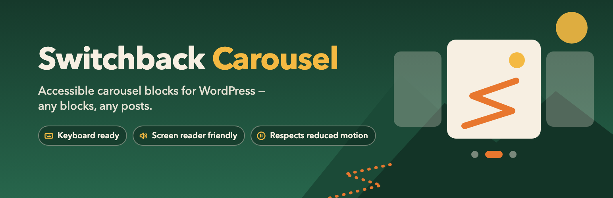
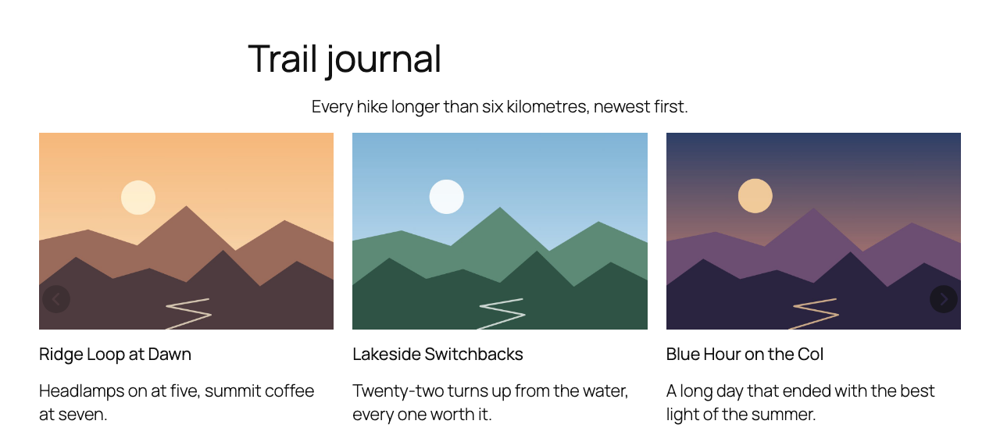
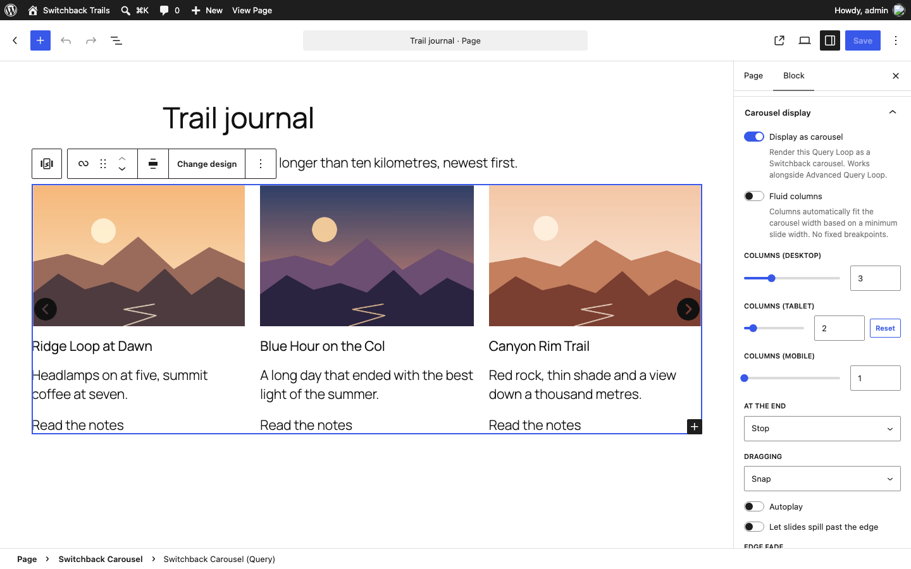
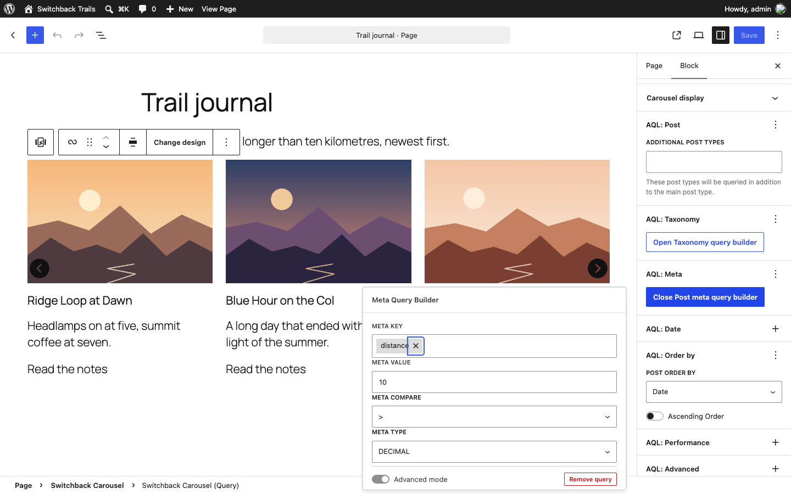
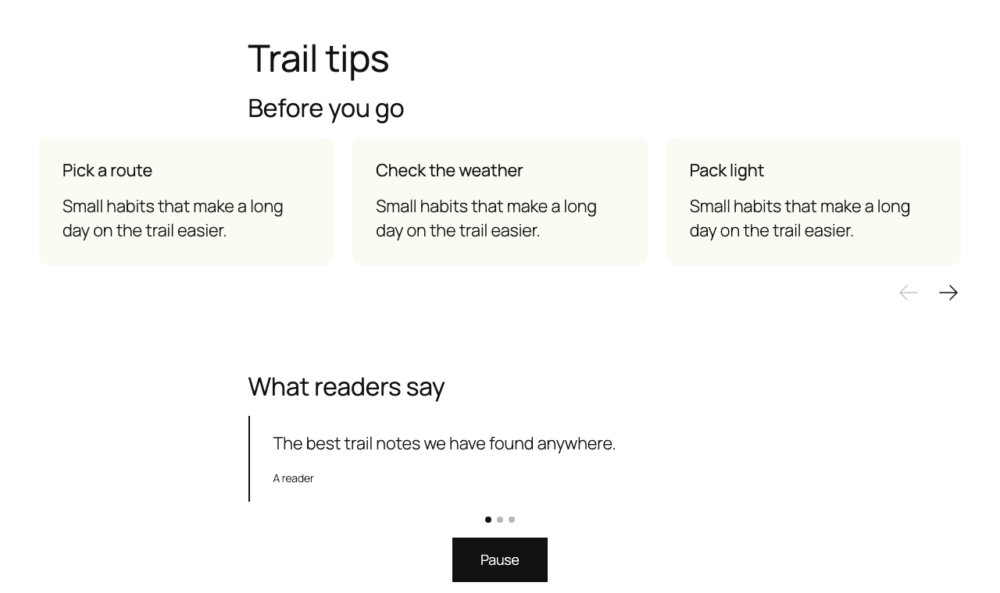
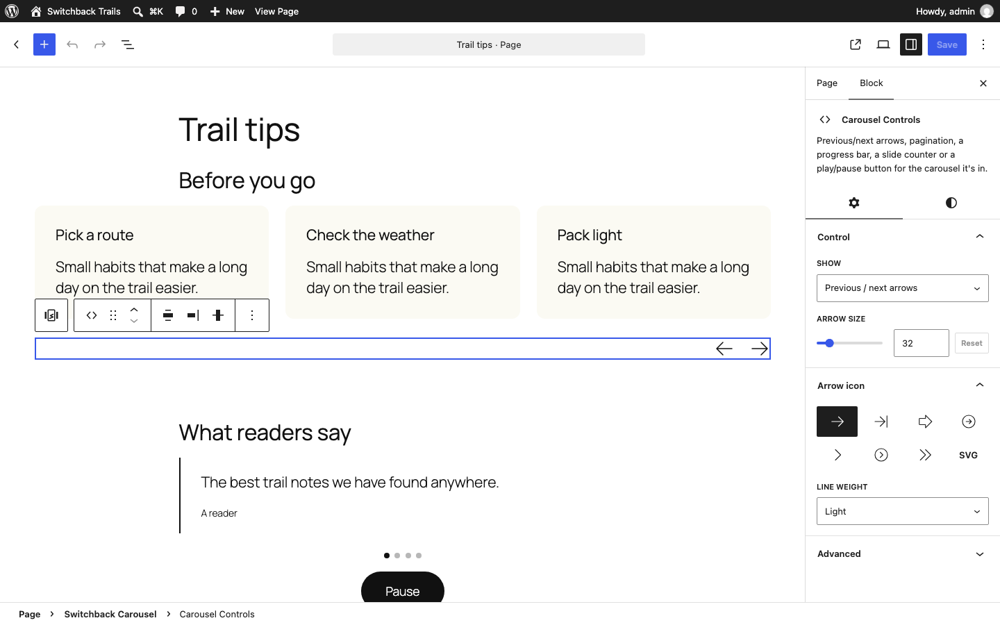
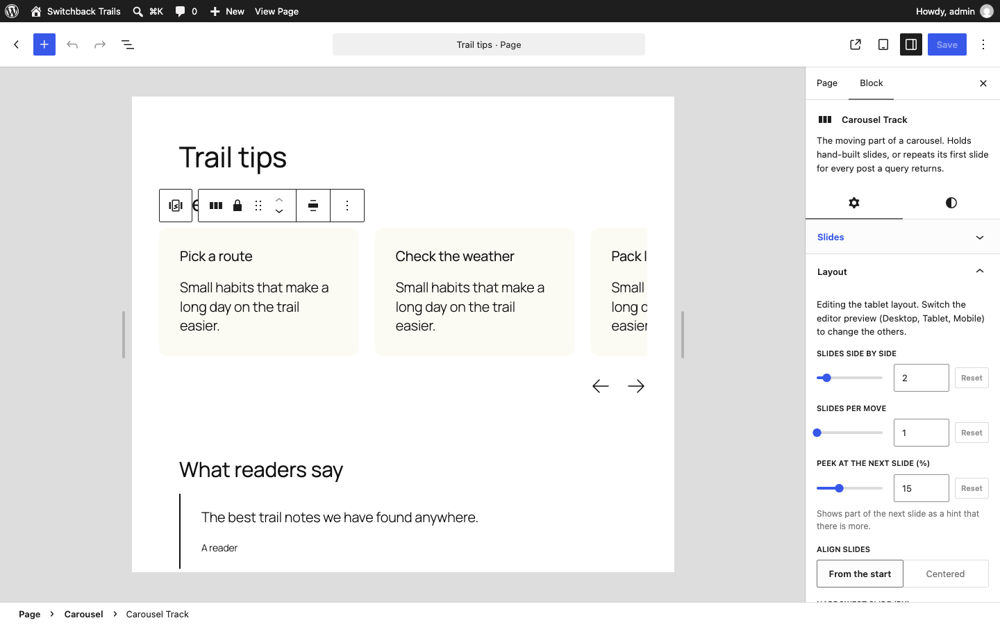

# Switchback Carousel



Accessible carousel blocks for WordPress. Build slides by hand, or turn any Query Loop into a carousel, including one powered by [Advanced Query Loop](https://wordpress.org/plugins/advanced-query-loop/). Sliding is powered by [Splide](https://splidejs.com/).

## Try it in WordPress Playground

No installation needed. Both links load [blueprint.json](blueprint.json), which installs Switchback Carousel, Advanced Query Loop and Twenty Twenty-Five, adds sample trail notes and events, and builds a showcase front page:

- **[See the showcase](https://playground.wordpress.net/?blueprint-url=https://raw.githubusercontent.com/bmx269/switchback-carousel/main/blueprint.json)**: a full-width fading hero, hand-built feature cards, a Query Loop carousel, Advanced Query Loop carousels filtered by a meta field and by `{today_ymd}`, split slides with controls inside them, a quote rotator, a centred gallery and a logo marquee.
- **[Open it in the editor](https://playground.wordpress.net/?blueprint-url=https://raw.githubusercontent.com/bmx269/switchback-carousel/main/blueprint.json&url=%2Fwp-admin%2Fpost.php%3Fpost%3D1000%26action%3Dedit)**: the same page in the block editor, logged in as admin.

The demo content lives in [playground/setup.php](playground/setup.php). Playground installs the plugin from a zip on the `playground` branch, which [.github/workflows/playground.yml](.github/workflows/playground.yml) rebuilds on every push to `main`.

## Screenshots

| | |
|---|---|
| [](.wordpress-org/screenshot-1.png)<br>A posts carousel on the front end, with arrows over the slides. | [](.wordpress-org/screenshot-2.png)<br>A Query Loop shown as a carousel: turn on **Display as carousel** and set columns, motion and edges in the block sidebar. |
| [](.wordpress-org/screenshot-3.png)<br>Filtering the same carousel with Advanced Query Loop's meta query: hikes longer than ten kilometres. | [](.wordpress-org/screenshot-4.png)<br>Feature cards and a fading quote rotator with pagination and a pause button. |
| [](.wordpress-org/screenshot-5.png)<br>Controls: arrows in seven icons and five weights, pagination, progress, counter and play/pause. | [](.wordpress-org/screenshot-6.png)<br>Layout per device: slides side by side, slides per move and a peek at the next slide. |

## Blocks

| Block | What it does |
|---|---|
| `switchback-carousel/carousel` | The wrapper. Holds the slides plus controls, headings, buttons or anything else. Can float the arrows over the slides. |
| `switchback-carousel/track` | The moving part for hand-built slides. Layout, motion, autoplay and edge settings live here. |
| `switchback-carousel/slide` | One hand-built slide. |
| `switchback-carousel/controls` | Previous/next arrows, pagination (dots, bars or segments), a progress bar, a slide counter, or a play/pause button. Put it anywhere inside the carousel, including inside a slide. Colour and alignment use core's own controls. |

Post carousels don't need a block of their own. Switchback adds a **Display as carousel** setting to the core Query Loop block (see [Carousels from posts](#carousels-from-posts)).

Saved content never contains Splide class names. The front-end script adds them when it mounts, so content doesn't depend on the slider library.

## Settings

- **Layout per device**: slides side by side, slides per move, and a peek at the next slide (%) for desktop, tablet (≤781px) and phones (≤480px), set by switching the editor's device preview. Tablet falls back to desktop; phones fall back to one slide. Narrowest/widest slide width, and slides aligned from the start or centered.
- **Motion**: slide or fade, transition time, what happens at the last slide (stop, rewind, endless), dragging (snap, glide freely, off), mouse wheel/trackpad, hand cursor, direction (site language, LTR, RTL).
- **Autoplay**: step by step or a continuous flow; pause on hover. Always pauses while a visitor focuses the carousel and for visitors who prefer reduced motion.
- **Edges**: let slides show past the track edge (for full-bleed layouts), fade both edges or the trailing edge.
- **Linked layout**: rearranging or restyling one hand-built slide updates the others while each keeps its content. Each slide also has **Copy layout to other slides**.
- **Accessibility**: built in, with nothing to switch on. See [Accessibility](#accessibility).
- **Without JavaScript** the slides remain a native horizontally scrolling row.

## Accessibility

Carousels are easy to get wrong for keyboard, screen reader and motion-sensitive visitors. Switchback sits on [Splide](https://splidejs.com/), which follows the [WAI-ARIA carousel pattern](https://www.w3.org/WAI/ARIA/apg/patterns/carousel/), and handles the controls it renders itself. None of it needs configuring.

### From Splide

- **Carousel semantics.** The track is a labelled region with `aria-roledescription="carousel"`, and each slide is a group with `aria-roledescription="slide"` and a position label such as "3 of 8".
- **Hidden slides stay out of the way.** Slides outside the view get `aria-hidden="true"`, and links and buttons inside them get `tabindex="-1"` until they scroll into view, so Tab only reaches what's on screen.
- **Live announcements.** A polite live region announces the new slide after a move. It turns off while autoplay runs, so screen readers aren't interrupted every few seconds.
- **Keyboard.** Left and right arrow keys move the carousel while it has focus, following the text direction in right-to-left languages.
- **Autoplay that gets out of the way.** Autoplay pauses whenever focus is inside the carousel, and on hover if **Pause while the pointer is over it** is on.
- **Reduced motion.** For visitors with `prefers-reduced-motion: reduce`, transitions are instant and step-by-step autoplay stays paused.

### Added by Switchback

- **A focusable track.** The track takes focus itself (`tabindex="0"`), so arrow keys work even when the slides contain nothing focusable, and it shows a visible focus outline.
- **Continuous autoplay respects reduced motion too.** Splide's reduced-motion setting doesn't cover its Auto Scroll extension, so Switchback holds continuous carousels (logo marquees) still for those visitors. They can still start one with the Play button.
- **Real buttons with labels.** Previous and next arrows are `<button>`s labelled "Previous slide" and "Next slide", and their icons are hidden from screen readers. Without looping, they're disabled at the first and last slide.
- **Pagination.** A list labelled "Choose a slide" of buttons labelled "Go to slide 3" (or "Go to page 3" when a move covers several slides). The current one has `aria-current`.
- **Progress bar.** A labelled slider (`role="slider"`, 0–100) that works with a click, a drag or the arrow keys.
- **Counter.** Reads "2 of 6". The visual slash is hidden from screen readers.
- **Play/pause.** A real button that appears only when autoplay is on. Its label says what it will do next ("Pause" or "Play"), as the WAI-ARIA carousel pattern recommends.
- **Visible focus** on every control, using the text colour so it follows your design.
- **No JavaScript, no lost content.** Before the script loads, or if it never does, the slides are a native horizontally scrolling row.
- **Translatable.** Every label goes through WordPress translations.

### Your part

Switchback handles the carousel. The content inside it is yours:

- Give images in slides alt text, or mark them decorative.
- Keep text on images readable: a Cover block's overlay helps with contrast.
- Add a **Play/pause** control to any carousel that autoplays. [WCAG 2.2.2](https://www.w3.org/WAI/WCAG22/Understanding/pause-stop-hide.html) asks for a way to stop motion that lasts more than five seconds. Pausing on focus and hover helps, but doesn't replace the button.

## Carousels from posts

Any Query Loop block can render as a carousel. WordPress picks the posts and Switchback handles the display:

1. Add a **Switchback Carousel** block and replace its track with a **Query Loop**, or start from the **Latest posts** pattern, which is already set up this way.
2. Select the Query Loop and turn on **Carousel display → Display as carousel**.
3. Design one post inside the Post Template. Every post becomes a slide.
4. Add **Carousel Controls** anywhere inside the Switchback Carousel for arrows, pagination and the rest.

The **Carousel display** panel on the Query Loop offers:

- **Columns** for desktop, tablet and mobile, or **Fluid columns**: set a minimum slide width and the carousel fits as many slides as the viewport allows, with no fixed breakpoints.
- **At the end**: stop, rewind or endless loop.
- **Dragging**: snap, glide freely or off.
- **Autoplay**: step by step or continuous, with an interval.
- **Edges**: let slides spill past the edge, or fade the trailing or both edges.

The gap between slides comes from the Query Loop's **Block spacing** setting.

The **Switchback Carousel (Query)** variation in the inserter is a shortcut for steps 1 and 2 with plain core queries.

### How it works

Switchback stores its settings in a `switchback` attribute on `core/query` and reads them in a `render_block_core/query` filter. The filter adds Splide's track markup and a `data-switchback` options blob around the rendered `core/post-template` list, then enqueues the same front-end script that hand-built tracks use. Switchback only changes the HTML after it is rendered. It doesn't touch the query, so anything that changes the query keeps working.

Carousel display switches on with `switchback.enabled`, not with the block's `namespace`. That matters for Advanced Query Loop, which identifies its blocks by `namespace: "advanced-query-loop"`. Because of this, a single Query Loop can be an AQL block and a Switchback carousel at the same time.

In the editor, the preview is a horizontal row styled with the same column and gap variables the front end uses. Splide only mounts on the front end.

### Advanced Query Loop

[Advanced Query Loop](https://wordpress.org/plugins/advanced-query-loop/) (AQL) is the recommended way to filter beyond what core's Query Loop offers: post meta and SCF/ACF field queries, date queries, multiple post types, including or excluding posts by ID, child posts, sorting by meta, and more. Switchback doesn't depend on AQL. Everything works on a plain Query Loop, and AQL adds query options on top.

To use them together:

1. Insert an **Advanced Query Loop** block inside a Switchback Carousel and set up the query with AQL's controls.
2. In the same block's sidebar, turn on **Carousel display → Display as carousel**.

The **Latest posts** pattern saves its Query Loop with AQL's namespace and carousel display on. With AQL active, AQL picks it up. Without AQL, it renders as a normal core Query Loop.

Start from an Advanced Query Loop block rather than the **Switchback Carousel (Query)** variation. The variation sets Switchback's own namespace, so AQL's controls won't appear on it.

### Relative dates and tokens

Switchback expands tokens in the final query arguments of every Query Loop. It hooks `query_loop_block_query_vars` for core and `aql_query_vars` for AQL, both at priority 20, after AQL has built its arguments. The main use is AQL's **meta query** values: a meta query of "`event_date` is greater than or equal to `{today_ymd}`" makes an upcoming-events carousel that never goes stale.

Tokens don't work in AQL's date query fields. AQL splits those dates into year, month and day before Switchback sees them, and its date picker doesn't accept typed text. For relative post dates, use AQL's built-in "before/after the current date" options.

| Token | Becomes |
|---|---|
| `{today}`, `{today+7}`, `{today-30}` | `2026-09-26` |
| `{today_ymd}` | `20260926`. SCF/ACF date pickers store dates this way. |
| `{now}` | `2026-09-26 14:05:00` |
| `{current_post_id}` | ID of the post being viewed |
| `{current_user_id}` | ID of the logged-in user |

Date tokens take a day offset. Tokens expand in any Query Loop, not only in carousels.

## Extending

### JavaScript

`window.switchback.mount( scope )` mounts carousels added to the page later (carousels inserted into the DOM are picked up automatically), `window.switchback.unmount( node )` tears them down, and `window.switchback.get( trackElement )` returns the Splide instance. Query Loop carousels count as tracks: the `.wp-block-query` element is the track.

### Changing queries

Post carousels are ordinary Query Loops, so use WordPress's `query_loop_block_query_vars` filter, or AQL's `aql_query_vars`, to change the query.

## Development

```bash
nvm use
npm install
npm run start        # watch
npm run build        # icons + production build
npm run build:icons  # regenerate includes/icons.json from @phosphor-icons/core
npm run test:unit
npm run lint:js
npm run lint:css
npm run plugin-zip   # distributable zip (honours .distignore)
```

Requires WordPress 6.7+ and PHP 8.0+.

## License

GPL-2.0-or-later. See [LICENSE](LICENSE) and [CREDITS.md](CREDITS.md).
